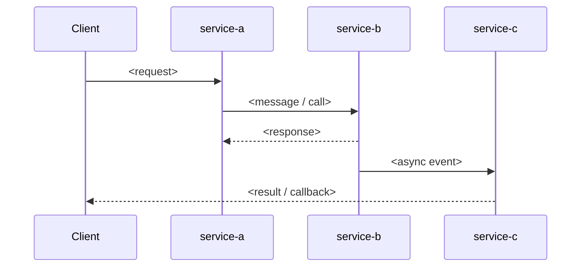

# <Workflow name> flow

> **Read when:** <one line, e.g. "you need to trace a request across services to find where it stalled">

## Purpose

<What this workflow achieves, who or what triggers it, and what "done" looks like.>

## Participants

| Service     | Role in this flow                 | Source of truth               |
| ----------- | --------------------------------- | ----------------------------- |
| <service-a> | <e.g. accepts request, validates> | <repo path / proto / OpenAPI> |
| <service-b> | <...>                             | <...>                         |

## Sequence

### Step by step

| #   | From → To  | Transport     | What happens | State after          |
| --- | ---------- | ------------- | ------------ | -------------------- |
| 1   | Client → A | HTTP/gRPC     | <...>        | <e.g. job `pending`> |
| 2   | A → B      | <queue/topic> | <...>        | <...>                |
| 3   | B → C      | <...>         | <...>        | <...>                |

## Contracts and invariants

Stable things that should stay true. Link to schemas instead of copying them.

- <Message/schema>: <link>
- <Ordering guarantee, idempotency key, retry/timeout policy, etc.>
- <Invariant, e.g. "a job is never `done` without an output object in storage">

## Failure points

| Step | What can go wrong           | Observable symptom         | How to confirm     | Debug guide                     |
| ---- | --------------------------- | -------------------------- | ------------------ | ------------------------------- |
| 2    | <e.g. message not consumed> | <e.g. job stays `pending`> | `<query / metric>` | [<guide>](../domains/<file>.md) |
| 3    | <...>                       | <...>                      | `<...>`            | <...>                           |

## Observability

- Correlation ID: <field name and where it propagates>
- Logs: <how to filter a single request across services>
- Traces: <where to find the trace>
- Metrics / dashboards: <links>

## Related

- Debug guides: [<guide>](../domains/<file>.md)
- Other flows: <...>

## Change notes

| Date       | Change                     | Verified by |
| ---------- | -------------------------- | ----------- |
| YYYY-MM-DD | <what changed in the flow> | <name>      |
