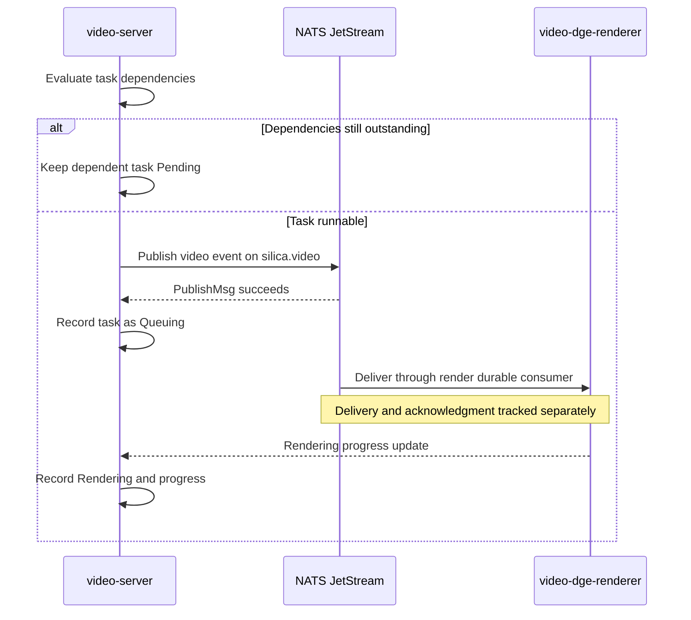

# Video render queue delivery flow

> **Read when:** video tasks stay Queuing despite healthy workers or zero consumer pending, and you need to locate the stalled handoff.

## Purpose

Trace runnable video work from video-server publication through NATS retention and consumer delivery to useful renderer progress. Dependent highlights can remain Pending while their child clips are Queuing; inspect children separately from aggregate session status.

Scope: retained evidence for video-server `1.6.5`, video-dge-renderer `0.4.6` (commit `51d77473cb32c5dae3e66e49efa0e9856b3c87cd`), and NATS `2.10.28`. Other versions are (unverified). Source paths below resolve from the configured `SILICA_REPO=../silica`, relative to the ops-agent root; inspect the specified tags rather than assuming the current checkout matches deployment.

The recorded recovery established delivery and child rendering progress. Final completion, upload, and visual correctness of every affected video remain (unverified); queue delivery alone does not establish those outcomes. Historical observations cite the [incident evidence ledger](../../../incidents/2026-11-03-usbaymkt-render-consumer-stalled.md#evidence-ledger); this migration rechecked selected source code, not live behavior.

## Participants

| Service            | Role in this flow                                                                 | Source of truth                                                                                                                                                                                                                                                                           |
| ------------------ | --------------------------------------------------------------------------------- | ----------------------------------------------------------------------------------------------------------------------------------------------------------------------------------------------------------------------------------------------------------------------------------------- |
| video-server       | Evaluates dependencies, publishes runnable work, and records task status/progress | [Render orchestration](../../../../../silica/apps/video/server/cores/render/render.go) at `video/v1.6.5`; incident E03/E06/E15                                                                                                                                                            |
| nats               | Retains matching work and delivers it through the durable render consumer         | [Publisher](../../../../../silica/libs/go/event/publish_nats.go) at `video/v1.6.5`; [consumer setup](../../../../../silica/libs/go/event/subscribe_nats.go) at `video-dge/v0.4.6`; deployed configuration in E09                                                                          |
| video-dge-renderer | Receives work through the bundled event library and performs rendering            | [Subscription](../../../../../silica/libs/go/event/subscribe_nats.go), [queue](../../../../../silica/libs/go/event/simplequeue/queue.go), and [queue lifecycle](../../../../../silica/libs/go/event/simplequeue/queue_start.go) at `video-dge/v0.4.6`; E06/E07/E17 and recovery readbacks |

## Sequence

Publication precedes the Queuing database update in video-server code. That update and asynchronous delivery are separate operations; the diagram does not guarantee their relative completion order. Renderer receipt and advancing application progress were observed in the incident; the exact progress-update transport is (unverified) here.

### Step by step

| #   | From → To                              | Transport                               | What happens                                                           | State after                                                                                                |
| --- | -------------------------------------- | --------------------------------------- | ---------------------------------------------------------------------- | ---------------------------------------------------------------------------------------------------------- |
| 1   | video-server → dependency/task records | Internal call and database              | Check whether child dependencies permit rendering                      | Dependent task remains Pending, or runnable work proceeds; E03 and render source                           |
| 2   | video-server → NATS                    | JetStream publish on `silica.video`     | Publish the render event; log success only after `PublishMsg` succeeds | Successful publication established; delivery/completion not established; E06/E15                           |
| 3   | video-server → task records            | Database                                | Set Queuing after successful publication                               | Application has queued the task; E03 and render source                                                     |
| 4   | NATS → video-dge-renderer              | Durable pull consumer                   | Deliver matching retained work to requesting workers                   | Delivery position advances; unacknowledged work may remain in flight; E09–E12                              |
| 5   | video-dge-renderer → video-server      | Progress update; transport (unverified) | Process the task and report progress                                   | Rendering/progress advances; one child completed in recovery readbacks; final output coverage (unverified) |

## Contracts and invariants

- Render payload: [payload definition](../../../../../silica/apps/video/server/cores/render/data.go) and [construction/state handling](../../../../../silica/apps/video/server/cores/render/render.go), at `video/v1.6.5`. Link to these contracts rather than copying the schema.
- Successful publication, retained matching work, consumer delivery, acknowledgment, rendering, and upload are separate evidence boundaries. No single health check or queue counter establishes all of them (E03/E04/E06/E09–E12/E15).
- The observed consumer filter matched the video subject, used deliver-new policy, explicit acknowledgments, and a delivery limit. Check actual deployment values, positions, and policies together before declaring retained messages eligible (E09–E12).
- `num_pending` describes undelivered work; it was zero despite eligible retained work in this incident. `num_ack_pending` describes delivered unacknowledged work, not active renders. `num_waiting` counts pulls, not unique healthy workers. Zero pending can coexist with substantial in-flight work (E09–E12 and recovery readbacks).
- Stream totals cover all subjects; per-subject counts alone do not prove eligibility relative to consumer positions. Metadata, stream, and consumer leaders can differ; use the exact object's leader when comparing state (E08/E09/E11/E12).
- Interest retention was observed. Removing consumer interest may remove queued messages (unverified deletion behavior in this incident); consumer deletion/rebuild is not equivalent to leadership transfer. A retained-count decrease during normal acknowledgments does not prove an explicit purge (E09 and recovery readbacks).
- Consumer errors stop consumption and close the connection; the queue lifecycle supplies intended reconnect behavior. This code does not establish a reconnect deadlock (unverified), nor does leadership-change timing identify a specific broker defect (unverified); E06/E17/E18.
- Renderer builds bundle the event library from their source checkout. A declared NATS dependency does not independently attest the deployed executable's compiled dependencies (unverified binary provenance); E07.

## Failure points

Requests below use placeholders for the actual environment, account, stream, consumer, and subject. They are read-only request shapes exercised in the incident, not live checks rerun during this edit. Query message metadata only; do not display or decode bodies, authentication details, or customer data. A consumer fetch or acknowledgment is not a substitute for these reads.

| Step | What can go wrong                                              | Observable symptom                                                          | How to confirm                                                                                                                                                                                                                                                                                                                                                                                                  | Debug guide                                                                                                                                                      |
| ---- | -------------------------------------------------------------- | --------------------------------------------------------------------------- | --------------------------------------------------------------------------------------------------------------------------------------------------------------------------------------------------------------------------------------------------------------------------------------------------------------------------------------------------------------------------------------------------------------- | ---------------------------------------------------------------------------------------------------------------------------------------------------------------- |
| 1    | Dependency wait hides the runnable child that stalled          | Parent Pending; child Queuing at zero progress                              | `GET <platform-https>/video/holodecks/<room>/session/<session>`: normal dependency wait has identifiable unfinished children; trace those children's status/progress rather than treating aggregate Pending as delivery failure (E03)                                                                                                                                                                           | [Application triage](../../../runbooks/docs/jetstream-consumer-delivery-stalled.md#1-establish-application-impact-and-dependencies)                              |
| 2    | Publication or subject routing fails                           | Task has no eligible retained work                                          | Compare publisher `Published event correlationID=... topic=... msgID=...` and `queueTask err` logs with `$JS.API.STREAM.INFO.<stream>` payload `{"subjects_filter":"<exact-subject>"}`. Normal: publish success plus matching retention or evidence of already delivered work. Abnormal: errors or producer/filter mismatch; absence of retained messages alone does not prove failed publication (E06/E11/E15) | [Delivery diagnosis](../../../runbooks/docs/jetstream-consumer-delivery-stalled.md#triage-read-only-in-order)                                                    |
| 4    | Consumer delivery/accounting stalls                            | Zero pending despite retained matching messages and fixed delivery position | `$JS.API.CONSUMER.INFO.<stream>.<consumer>` with `{}`; `$JS.API.STREAM.MSG.GET.<stream>` with `{"seq":<last-delivered-plus-one>,"next_by_subj":"<exact-subject>"}` and `{"last_by_subj":"<exact-subject>"}`. Normal: no eligible retained work, or delivery advances. Abnormal: matching sequences beyond a fixed position, waiting pulls, and no policy/limit explanation (E09–E12)                            | [Delivery diagnosis and recovery guards](../../../runbooks/docs/jetstream-consumer-delivery-stalled.md#triage-read-only-in-order)                                |
| 4    | Follower or stale snapshots mislead diagnosis                  | Conflicting counters or replica lag                                         | `GET http://<monitoring-address>:<monitoring-port>/jsz?accounts=true&streams=true&consumers=true&config=true` across brokers, plus consumer-info above. Normal: the object's leader reports current replicas; follower disagreement alone does not confirm cluster-wide failure. Abnormal: persistent adverse state corroborated by the object's leader (E08/E09)                                               | [Leader-aware triage](../../../runbooks/docs/jetstream-consumer-delivery-stalled.md#triage-read-only-in-order)                                                   |
| 4–5  | Workers are unavailable, or liveness masks lack of useful work | Passing health checks without advancing child progress                      | `GET http://<monitoring-address>:<monitoring-port>/connz?subs=true&limit=1024` on each broker; check pagination and known worker connections, then repeat the application request. Normal: receipt and child progress advance. Abnormal: connections absent, or present without advancing delivery/progress; connections alone do not isolate the cause (E03/E04/E10)                                           | [Worker/publication checks](../../../runbooks/docs/jetstream-consumer-delivery-stalled.md#4-corroborate-useful-workers-publication-and-version-matched-behavior) |

If the delivery boundary is progressing normally, investigate rendering inputs/errors and upload separately. Procedures for those later boundaries are (unverified) in this flow. Monitoring refusal alone can be an access-path failure; the incident reached monitoring through its registered LAN address after loopback refusal (E24).

## Observability

- Correlation: the [publisher](../../../../../silica/libs/go/event/publish_nats.go) injects tracing headers and, when available, `X-Trace-ID`; it creates `Nats-Msg-Id`. The [subscriber](../../../../../silica/libs/go/event/subscribe_nats.go) extracts headers and logs `correlationID`, `topic`, and `msgID`. Application payload construction includes session, item, and request identifiers. Complete end-to-end correlation coverage is (unverified).
- Logs: discover the actual Loki datasource and labels first. The incident used `cluster` and `job` labels with jobs `video/server`, `video-dge/renderer`, and `infra/nats`. Example parameterized query: `{cluster="<CLUSTER>",job="video/server"} |= "<TRACE_ID>"`; this exact substituted query is (unverified). Scope the time window and account for limits, rotation, missing files, partial reads, and replayed startup timestamps before drawing absence or restart conclusions (E13–E17/E19–E24).
- Traces: source creates `nats publish` and `nats consume` spans with messaging attributes. A working deployed trace view/dashboard is (unverified); no URL is established by the retained evidence.
- Queue state: correlate per-subject retention, delivered/acknowledged positions, pending/in-flight/waiting counts, current replicas, and the exact object leader with application child progress. No dedicated stall metric or dashboard was verified; use the read-only requests above (E08–E12).

## Related

- Debug/recovery procedure: [JetStream consumer delivery stall runbook](../../../runbooks/docs/jetstream-consumer-delivery-stalled.md). No platform domain debug guide exists yet; remediation stays in the runbook.
- [Source incident and evidence ledger](../../../incidents/2026-11-03-usbaymkt-render-consumer-stalled.md): one consumer-only leadership transfer restored delivery and rendering progress without changing consumer configuration or stream leadership. The exact broker defect, trigger mechanism, and effectiveness elsewhere remain (unverified).
- [Diagnosis lessons and toolkit improvements](../../../debrief/docs/2026-11-03-usbaymkt-render-consumer-stalled.md).
- [Diagnosis workflow](../../../../docs/diagnose_agent.md).

## Change notes

| Date       | Change                                                                                                             | Verified by                                                                                                                                                                        |
| ---------- | ------------------------------------------------------------------------------------------------------------------ | ---------------------------------------------------------------------------------------------------------------------------------------------------------------------------------- |
| 2026-11-10 | Migrated retained queue-delivery knowledge to the flow template; added sequence, boundary checks, and source links | Authoring/source review only; selected publisher, render-state, and subscriber code checked at deployed tags. No live or end-to-end re-verification; `last_verified` remains null. |
