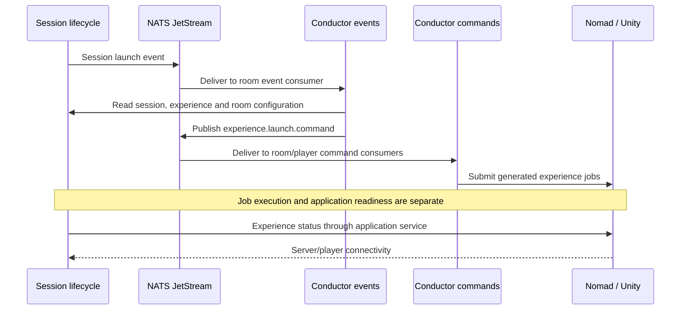

# Unity launch command delivery flow

> **Read when:** server/player Unity launches stall and you need to distinguish queue delivery, process creation and application readiness.

## Purpose

Trace a session launch through the shared event/command path to Nomad job creation and application connectivity. Working scheduler allocations alone do not establish command delivery or a ready Unity process.

Scope: current configured platform checkout inspected at `f190e60fb`, plus retained logs and live storage checks in the [source incident](../../../incidents/2026-11-14-atwiecol-sata-io-unity-launch.md). The exact incident-deployed source revision and a complete end-to-end launch trace are (unverified). `last_verified` records this source/evidence review, not validation of a repair.

## Participants

| Service                       | Role                                                                                         | Source of truth                                                                                                                                                                                                                             |
| ----------------------------- | -------------------------------------------------------------------------------------------- | ------------------------------------------------------------------------------------------------------------------------------------------------------------------------------------------------------------------------------------------- |
| session-server                | Session lifecycle and experience connectivity/health                                         | [Experience health data source](../../../../../silica/apps/session/server/src/infras/silica_experiences/experience_health_data_source.go)                                                                                                   |
| experience-conductor/events   | Receives launch event, reads session/experience/room configuration, publishes launch command | [Event handler](../../../../../silica/apps/experience-conductor/events/src/agent/session_launch_consumer.go), [publisher](../../../../../silica/apps/experience-conductor/events/src/experience/service.go)                                 |
| nats                          | Shared event/command transport with JetStream persistence                                    | [Queue lifecycle](../../../../../silica/libs/go/event/simplequeue/queue_start.go), [broker storage template](../../../../../silica/apps/infra/terraform-module/templates/nats.nomad.hcl.tftpl)                                              |
| experience-conductor/commands | Handles room/player launch commands and submits experience jobs                              | [Command handler](../../../../../silica/apps/experience-conductor/commands/src/agent/launch_consumer.go), [launch service](../../../../../silica/apps/experience-conductor/commands/src/experience/service.go)                              |
| Nomad / Unity                 | Executes generated jobs; application reports connectivity separately                         | [Job rendering](../../../../../silica/apps/experience-conductor/commands/src/experience/render_nomad_job.go), [health conversion](../../../../../silica/apps/session/server/src/infras/silica_experiences/experience_health_data_source.go) |

## Sequence

The diagram summarizes source boundaries. It is not evidence that every historical event reached each step; the original lifecycle publication and full historical end-to-end trace are (unverified).

### Step by step

| #   | From → To                    | Transport                      | What happens                                                                     | Evidence boundary                                                 |
| --- | ---------------------------- | ------------------------------ | -------------------------------------------------------------------------------- | ----------------------------------------------------------------- |
| 1   | Lifecycle → events agent     | Queue                          | Room handler receives launch notification and reads required configuration       | Event receipt does not prove command publication                  |
| 2   | Events agent → command queue | `experience.launch.command`    | Publishes room/player launch parameters                                          | Publication does not prove consumption                            |
| 3   | Command agent → Nomad        | Nomad service calls            | Filters relevant room/player, handles current job state and creates rendered job | Current source behavior; historical deployed guards (unverified)  |
| 4   | Nomad → Unity                | Generated execution tasks      | Runs experience process and associated checks                                    | Allocation running does not prove visual/game readiness           |
| 5   | Session health → application | Experience status HTTP request | Maps connected flags into health; request failures yield unhealthy data          | Health can fail because the server service never became available |

## Contracts and invariants

- Payload definitions and publishing behavior: [event service](../../../../../silica/apps/experience-conductor/events/src/experience/service.go), [command payload](../../../../../silica/apps/experience-conductor/commands/src/agent/launch_consumer.go). Correlate session, room and player identity rather than relying on process counts.
- The [queue start loop](../../../../../silica/libs/go/event/simplequeue/queue_start.go) can return after exhausted reconnection attempts; [command-agent main](../../../../../silica/apps/experience-conductor/commands/src/main.go) panics on the returned error. Exact deployed recovery settings are (unverified); retained panics confirm this failure signature in the source incident.
- Identify the broker's actual persistence mount before attributing errors to NAS or local disk. The [template](../../../../../silica/apps/infra/terraform-module/templates/nats.nomad.hcl.tftpl) uses a host bind mount; deployed overrides must be checked.
- Strong storage attribution requires independent kernel and broker evidence. Leadership changes alone do not establish a storage fault.
- A running broker process can retain a failed Raft-node write state. In the source incident's broker version, stream health surfaces the retained write error; repeated not-current warnings do not imply repeated new synchronizations. Enabled-only health checks skip stream/consumer checks. Compare the actual rendered check before inferring why Nomad did not restart a broker. See the [incident follow-up](../../../incidents/2026-11-14-atwiecol-sata-io-unity-launch.md#follow-up-why-sync-and-was-the-nats-job-unstable) for version-matched upstream sources and lifecycle evidence.

## Failure points

| Step | Failure                                     | Observable symptom                                                                          | How to confirm                                                                                                                                               | Procedure                                                                                                                                              |
| ---- | ------------------------------------------- | ------------------------------------------------------------------------------------------- | ------------------------------------------------------------------------------------------------------------------------------------------------------------ | ------------------------------------------------------------------------------------------------------------------------------------------------------ |
| 1–3  | Persistent storage stops completing writes  | Broker sync errors, lost quorum, queued commands delayed or unavailable                     | Time-align kernel `DID_TIME_OUT`/SATA resets with NATS `input/output error`, `NO quorum` and conductor panics; normal case has advancing delivery and writes | [Storage/launch runbook](../../../runbooks/docs/sata-io-jetstream-launch-failure.md)                                                                   |
| 1–2  | Required configuration cannot be read       | Event handler logs `Failed to get session`, `Failed to get experience` or room-config error | Correlate the exact session with handler logs and dependent responses; working case publishes the launch command                                             | Source handlers above; specific recovery (unverified)                                                                                                  |
| 3–4  | Nomad submission or execution fails         | Create/delete job errors or task startup failures                                           | Inspect the exact job and allocation events; normal case progresses to process creation                                                                      | Source launch service/job renderer; procedure beyond this incident (unverified)                                                                        |
| 4–5  | Process exists but application is not ready | Server/player health remains disconnected or clients wait for the server                    | Inspect application connectivity and Unity logs for the same session, then perform human visual validation                                                   | [Game initialization runbook](../../../runbooks/docs/unity-black-screen-empty-device-friendly-name.md), only if its distinct failure signature matches |

## Observability

- Discover the actual Loki datasource and labels first; filter by store cluster and jobs for conductor events/commands, broker, kernel journal and experience tasks. Use explicit UTC windows and inspect truncation/retention before interpreting absent events.
- Correlate `sessionID`, room/player and allocation identity from handler and task logs. An unavailable experience service name can be a downstream symptom of a missing/unready server, not proof that DNS itself is the original defect.
- Discover disk/CPU metrics before querying. Sampled write-completion latency and I/O wait corroborate storage stalls but do not identify a specific SSD/controller/firmware defect. Exact queries and normal/abnormal criteria are in the runbook.
- Trace coverage and a dedicated launch-delivery dashboard are (unverified).

## Related

- [Source incident and evidence ledger](../../../incidents/2026-11-14-atwiecol-sata-io-unity-launch.md)
- [Storage/launch triage runbook](../../../runbooks/docs/sata-io-jetstream-launch-failure.md)
- [Diagnosis debrief](../../../debrief/docs/2026-11-17-atwiecol-sata-io-unity-launch.md)

## Change notes

| Date       | Change                                                                  | Verified by                                                                                                                  |
| ---------- | ----------------------------------------------------------------------- | ---------------------------------------------------------------------------------------------------------------------------- |
| 2026-11-17 | Added shared launch-delivery boundaries and storage-failure correlation | Source inspection, retained incident logs/metrics and live read-only device checks; no remediation or full launch validation |
